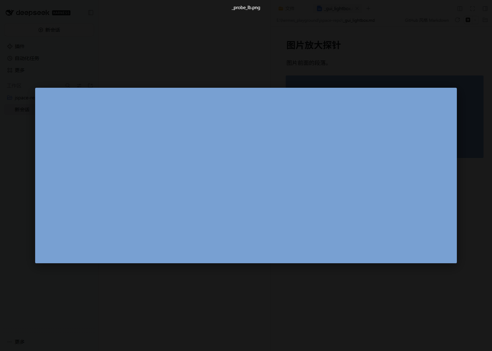

# dsh-live-markdown

English | [中文](README.zh.md)

**Obsidian-style Live Preview for Markdown inside [DeepSeek Harness](https://github.com/deepseek-ai/deepseek-harness).** A Markdown file opens in a single view where every block renders in place, and only the block — or the whole selection — you are editing shows its raw Markdown. No more switching between a rendered page and a source buffer.


## What you get

- **Block-level editing.** The active line (or the active selection) shows source; everything else stays rendered — the Live Preview behaviour of Obsidian.
- **Measured against real Obsidian.** The numbers come from reading Obsidian 1.15.1 through the DevTools protocol, not from guessing: body line-height **1.5**, heading `padding-top` **16px**, list rows **26–27px**, table cells **29.8px** tall with **4px/8px** padding and **1px `#e4e4e4`** borders, tables sized to content, image radius **4px**.
- **Images.** A full-line `![[image.png]]` renders as a block widget so it occupies exactly its own height (no phantom line box), `![[image.png|300]]` sets the width, and **double-click** opens an Obsidian-style lightbox: 90 % black backdrop, image fitted to the viewport, filename titlebar, close with backdrop click or <kbd>Esc</kbd>.
- **Folding** for headings, bullet lists, ordered lists and task lists — hover the row for the chevron; folded state is remembered per file.
- **Editing keymap** that behaves like Obsidian: <kbd>Enter</kbd> continues or exits lists/quotes, <kbd>Backspace</kbd> removes a list marker, <kbd>Tab</kbd>/<kbd>Shift+Tab</kbd> indent, <kbd>Ctrl+B</kbd>/<kbd>Ctrl+I</kbd> toggle bold/italic, <kbd>Ctrl+K</kbd> inserts a wikilink, <kbd>Ctrl+Enter</kbd> toggles a task, <kbd>Ctrl+Shift+K</kbd> deletes a line, <kbd>Ctrl+Shift+V</kbd> pastes plain text, <kbd>Ctrl+S</kbd> saves.
- **Tables** edit in place: click a cell and type, <kbd>Tab</kbd> moves between cells, right-click for insert/delete row or column and alignment.
- **Blocks** render with Obsidian's look: callouts (type colours, Lucide icons, `-`/`+` folding), quotes, task lists, code fences with a language label and copy button, KaTeX math, frontmatter properties card (tags as pills), footnotes as superscripts, `==highlight==`, `<kbd>`.
- **Links and embeds.** `[[note|alias]]` renders with the alias, `![[note]]` embeds the target note inline, hovering a wikilink shows a preview card, `![[image]]`/`` render inline.
- **Images you paste or drop** are written next to the note and inserted as `![[name]]`.
- **Long documents stay fast.** Decorations are built per viewport: a 6 600-line note rebuilds its decorations in ~5 ms and completes a keystroke in ~10 ms.
- **No keystrokes lost.** Change propagation is throttled for performance but flushed before saving, switching files, or unmounting.

## Screenshots

Tables and images follow Obsidian's box metrics; the table is sized to its content, the image fills the text column:


Double-click an image for the lightbox (same structure as Obsidian's: backdrop, fitted image, filename titlebar):



Headings, paragraphs and lists use Obsidian's measured row heights:


## Install

### Requirements

- DSH **0.2.2-rc.3** or newer (declared as `engines.dsh`). The plugin is a DSH *bundle*: it needs no install script, so no build approval is requested.
- Nothing else. CodeMirror 6, marked, KaTeX, DOMPurify, Shiki and the Literata font are vendored inside the package, so the preview works offline.

### From GitHub

```sh
dsh plugin --profile desktop add github:Paradeluxe/dsh-live-markdown
```

Use the profile you actually run — `desktop` for the Desktop app. In the app you can also use **Plugins → Add plugin** and point it at a local checkout.

### From npm

```sh
dsh plugin --profile desktop add @paradeluxe/dsh-live-markdown
```

If that package is not on npm yet, use the GitHub command above; both install the same code.

### Turn it on

Open **Plugins**, find **Obsidian-style Markdown preview** and make sure it is enabled, then open any `.md` file from the workspace panel. The preview header keeps a switch back to the official renderer, so nothing is forced on you.

## Obsidian parity

[`PARITY.md`](PARITY.md) lists 52 Live Preview behaviours with their status and the check that covers each one. A few entries from the measured set:

| Behaviour | Obsidian 1.15.1 (measured) | This plugin |
|---|---|---|
| Active block shows source, the rest renders | ✓ | ✓ |
| Unfocused editor renders everything | ✓ | ✓ |
| Active range = whole selection | ✓ | ✓ |
| Body / heading row heights | 24px / 45–48px (16px heading padding) | 24px / 44–47px |
| Table cells | 29.8px tall, `4px 8px` padding, 1px `#e4e4e4` | 29.8px, `4px 8px`, 1px `#e4e4e4` |
| Image click | single click does nothing, double-click opens lightbox | same |
| Lightbox | `.lightbox` + `rgba(0,0,0,.9)` backdrop + filename bar | same |
| Wikilink click | opens the target note | copies the target (see limitations) |

Known limitations, recorded honestly in `PARITY.md`:

- **Wikilink/embed clicks copy the target instead of opening it** — DSH's document preview has no host API for opening another file.
- **The properties card edits raw YAML**; Obsidian's property type picker and "add property" affordances are not replicated.
- Graph view, backlinks, command palette and Vim mode are host or editor features outside a Markdown renderer.
- Colours approximate Obsidian's light theme; dark-theme tuning is basic.

## How it works

`index.js` is the Host half: it registers the document-preview renderer and a small workspace API (list/tree/read/save plus `asset` for pasted images) on the desktop app's local server. `client.js` is the web half: it owns the preview panel, mounts one CodeMirror 6 `EditorView` for the whole note, and keeps decorations, block widgets, fold state, selection, undo history and save throttling in per-file memory. `src/cm6-entry.js` is the CodeMirror side of that editor and is bundled into `vendor/cm6-live-preview.js` by `scripts/build-client.mjs`.

## Development

```sh
npm install
npm run build:client   # src/cm6-entry.js -> vendor/cm6-live-preview.js
npm run smoke          # renders a sample document through the Host renderer
```

The plugin is verified against DSH 0.2.2-rc.3 with an automated Playwright suite (42 scripts / >200 assertions) that drives a real DSH instance: active-line semantics, folding, keymap, tables, callouts, embeds, image paste, lightbox, long-document scrolling and save/reopen integrity. The suite runs against a throwaway DSH profile; it is not shipped in this package.

## Third-party assets

Vendored under `vendor/`, each under its own licence:

| Asset | Licence |
|---|---|
| CodeMirror 6 | MIT |
| marked, marked-footnote | MIT |
| KaTeX | MIT |
| Shiki | MIT |
| DOMPurify | Apache-2.0 OR MPL-2.0 |
| Literata (font) | SIL Open Font License 1.1 |

## License

MIT — see [LICENSE](LICENSE).
