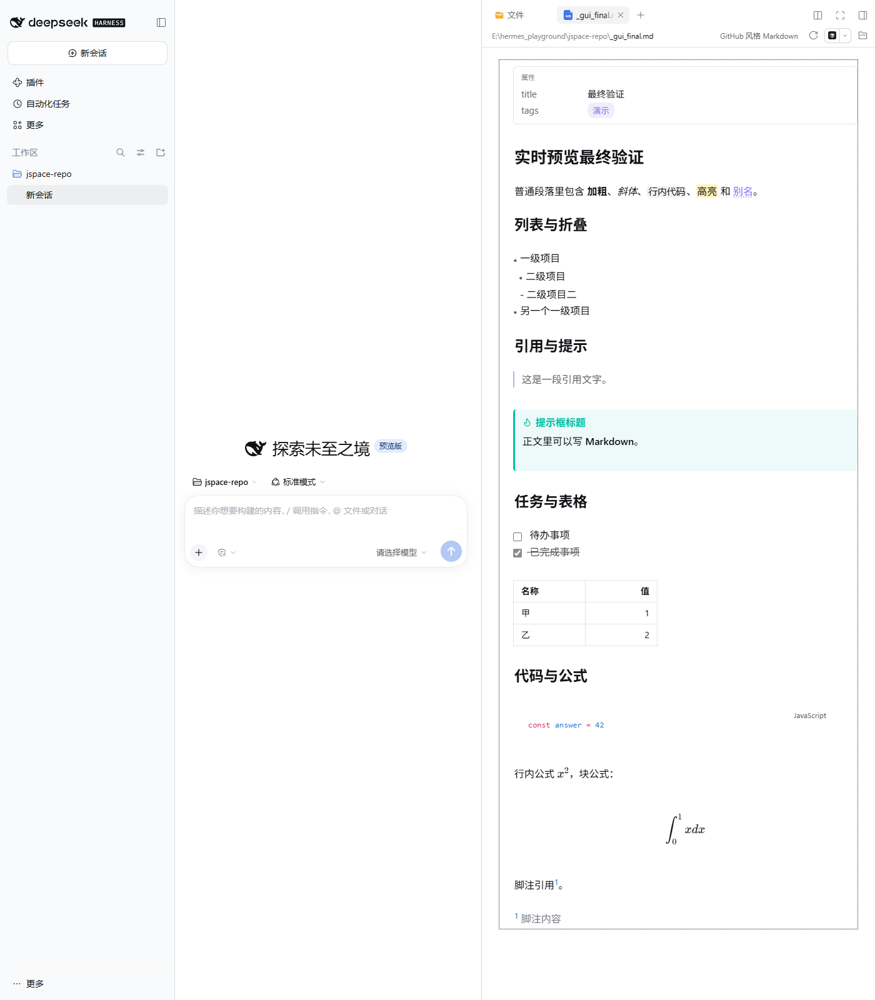
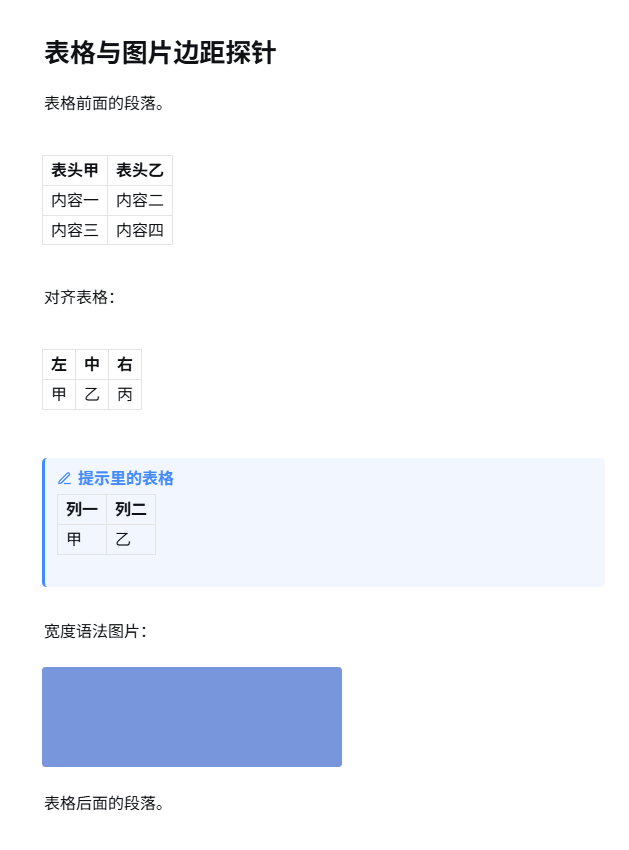

# dsh-live-markdown

English | [中文](README.zh.md)

**Obsidian-style Live Preview for Markdown inside [DeepSeek Harness](https://github.com/deepseek-ai/deepseek-harness).** A Markdown file opens in a single view where every block renders in place, and only the block — or the whole selection — you are editing shows its raw Markdown. No more switching between a rendered page and a source buffer.



## What you get

- **Block-level editing.** The active line (or the active selection) shows source; everything else stays rendered — the Live Preview behaviour of Obsidian.
- **Measured against real Obsidian.** The numbers come from reading Obsidian 1.15.1 through the DevTools protocol, not from guessing: body line-height **1.5**, heading `padding-top` **16px**, list rows **26–27px**, table cells **29.8px** tall with **4px/8px** padding and **1px `#e4e4e4`** borders, tables sized to content, image radius **4px**.
- **Images.** A full-line `![[image.png]]` renders as a block widget so it occupies exactly its own height (no phantom line box), `![[image.png|300]]` sets the width, and **double-click** opens an Obsidian-style lightbox: 90 % black backdrop, image fitted to the viewport, filename titlebar, close with backdrop click or <kbd>Esc</kbd>.
- **Folding** for headings, bullet lists, ordered lists and task lists — hover the row for the chevron; folded state is remembered per file.
- **Editing keymap** that behaves like Obsidian: <kbd>Enter</kbd> continues or exits lists/quotes, <kbd>Backspace</kbd> removes a list marker, <kbd>Tab</kbd>/<kbd>Shift+Tab</kbd> indent, <kbd>Ctrl+B</kbd>/<kbd>Ctrl+I</kbd> toggle bold/italic, <kbd>Ctrl+K</kbd> inserts a wikilink, <kbd>Ctrl+Enter</kbd> toggles a task, <kbd>Ctrl+Shift+K</kbd> deletes a line, <kbd>Ctrl+Shift+V</kbd> pastes plain text, <kbd>Ctrl+S</kbd> saves.
- **Tables** edit in place: click a cell and type, <kbd>Tab</kbd> moves between cells, right-click for insert/delete row or column and alignment.
- **Blocks** render with Obsidian's look: callouts (type colours, Lucide icons, `-`/`+` folding), quotes, task lists, code fences with a language label and copy button, KaTeX math, frontmatter properties card (tags as pills), footnotes as superscripts, `==highlight==`, `<kbd>`.
- **Links and embeds.** `[[note|alias]]` renders with the alias, `![[note]]` embeds the target note inline, hovering a wikilink shows a preview card, `![[image]]`/`` render inline.
- **Images you paste or drop** are written next to the note and inserted as `![[name]]`.
- **Long documents stay fast.** Decorations are built per viewport: a 6 600-line note rebuilds its decorations in ~5 ms and completes a keystroke in ~10 ms.
- **No keystrokes lost.** Change propagation is throttled for performance but flushed before saving, switching files, or unmounting.

## Screenshots

Tables and images follow Obsidian's box metrics; the table is sized to its content, the image fills the text column:



Double-click an image for the lightbox (same structure as Obsidian's: backdrop, fitted image, filename titlebar):


Headings, paragraphs and lists use Obsidian's measured row heights:


## Install

### Requirements

- DSH **0.2.2-rc.3** or newer (declared as `engines.dsh`). The plugin is a DSH *bundle*: it needs no install script, so no build approval is requested.
- Nothing else. CodeMirror 6, marked, KaTeX, DOMPurify, Shiki and the Literata font are vendored inside the package, so the preview works offline.

### From GitHub

```sh
dsh plugin --profile desktop add github:Paradeluxe/dsh-live-markdown
```

Use the profile you actually run — `desktop` for the Desktop app. In the app you can also use **Plugins → Add plugin** and point it at a local checkout.

### From npm

```sh
dsh plugin --profile desktop add @paradeluxe/dsh-live-markdown
```

If that package is not on npm yet, use the GitHub command above; both install the same code.

### Turn it on

Open **Plugins**, find **Obsidian-style Markdown preview** and make sure it is enabled, then open any `.md` file from the workspace panel. The preview header keeps a switch back to the official renderer, so nothing is forced on you.

## Obsidian parity

[`PARITY.md`](PARITY.md) lists 52 Live Preview behaviours with their status and the check that covers each one. A few entries from the measured set:

| Behaviour | Obsidian 1.15.1 (measured) | This plugin |
|---|---|---|
| Active block shows source, the rest renders | ✓ | ✓ |
| Unfocused editor renders everything | ✓ | ✓ |
| Active range = whole selection | ✓ | ✓ |
| Body / heading row heights | 24px / 45–48px (16px heading padding) | 24px / 44–47px |
| Table cells | 29.8px tall, `4px 8px` padding, 1px `#e4e4e4` | 29.8px, `4px 8px`, 1px `#e4e4e4` |
| Image click | single click does nothing, double-click opens lightbox | same |
| Lightbox | `.lightbox` + `rgba(0,0,0,.9)` backdrop + filename bar | same |
| Wikilink click | opens the target note | copies the target (see limitations) |

Known limitations, recorded honestly in `PARITY.md`:

- **Wikilink/embed clicks copy the target instead of opening it** — DSH's document preview has no host API for opening another file.
- **The properties card edits raw YAML**; Obsidian's property type picker and "add property" affordances are not replicated.
- Graph view, backlinks, command palette and Vim mode are host or editor features outside a Markdown renderer.
- Colours approximate Obsidian's light theme; dark-theme tuning is basic.

## How it works

`index.js` is the Host half: it registers the document-preview renderer and a small workspace API (list/tree/read/save plus `asset` for pasted images) on the desktop app's local server. `client.js` is the web half: it owns the preview panel, mounts one CodeMirror 6 `EditorView` for the whole note, and keeps decorations, block widgets, fold state, selection, undo history and save throttling in per-file memory. `src/cm6-entry.js` is the CodeMirror side of that editor and is bundled into `vendor/cm6-live-preview.js` by `scripts/build-client.mjs`.

## Verification

Every number quoted above was measured against a real DSH instance with Playwright, and against Obsidian 1.15.1 for the layout values. [docs/VERIFICATION.md](docs/VERIFICATION.md) records the environment, the 42-script GUI suite, the measurements behind each claim, and what remains unverified.

## Development

```sh
npm install
npm run build:client   # src/cm6-entry.js -> vendor/cm6-live-preview.js
npm run smoke          # renders a sample document through the Host renderer
```

The plugin is verified against DSH 0.2.2-rc.3 with an automated Playwright suite (42 scripts / >200 assertions) that drives a real DSH instance: active-line semantics, folding, keymap, tables, callouts, embeds, image paste, lightbox, long-document scrolling and save/reopen integrity. The suite runs against a throwaway DSH profile; it is not shipped in this package.

## Third-party assets

Vendored under `vendor/`, each under its own licence:

| Asset | Licence |
|---|---|
| CodeMirror 6 | MIT |
| marked, marked-footnote | MIT |
| KaTeX | MIT |
| Shiki | MIT |
| DOMPurify | Apache-2.0 OR MPL-2.0 |
| Literata (font) | SIL Open Font License 1.1 |

## License

MIT — see [LICENSE](LICENSE).

## 1.0.1（v1.0.1）

- 把开发期的测量与设计记录并入仓库：`docs/SPEC.md`（逐轮实现记录与实测数据）、`docs/DESIGN.md`（架构决策）。
- `scripts/render-smoke.mjs` 不再依赖外部目录，`npm install && npm run smoke` 即可运行。
- 这个仓库同时也是开发用工作副本，验证环境通过 `link:` 指向它，避免"开发目录 / 发布仓库"两份代码漂移。

- 重建窗口内可能出现"占位克隆 + 真实编辑器"并存，已加去重（宿主里只保留真实编辑器），占位克隆 `pointer-events:none`，真实编辑器带 `data-ghmd-live` 标记。

## 1.0.2（v1.0.2）

- 每个文件记住滚动位置：切走再回来、或宿主重挂载预览时，不再跳回文档顶部。
- 排查打字时"闪动/跳动"：在真实实例里用脚本逐字输入（英文 26 键、中文输入法组合输入、长文档内部滚动、小窗口）采样光标屏幕坐标与滚动位置，未复现光标或滚动位移；本轮先修掉"重挂载跳回顶部"这一确定会跳的原因。

## 1.0.3（v1.0.3）

修掉「一打字就闪、跳」的根因：DSH 文档预览在文件内容/mtime 变化时会重建整个预览组件，自动保存因此每 200ms 一次地把编辑器拆掉重建，表现为页面闪动。

- 自动保存防抖 200ms → 700ms（只在停手后写盘；`Ctrl+S` 立即保存）；
- 预览重建时用**上一帧 DOM 克隆占位**（React ref 在 paint 前填充），新编辑器挂载后替换占位，逐帧采样 **0 空白帧**；
- 配合 1.0.2 的滚动位置记忆与已有的光标/折叠记忆，重建后光标、滚动位置保持不变。

## 1.0.4（v1.0.4）

- 自动保存防抖进一步提到 **1500ms**：连续打字（含 1 秒内的停顿）不再触发重建，撤销栈因此不会被重建打断；
- 重挂载占位只对**同一个文件**复用（切换文件时不再可能闪现上一篇内容）；
- 关闭窗口/切后台时用 `sendBeacon` 兜底保存（防抖期间的输入不会丢）；
- 占位快照 `pointer-events:none`，真实编辑器 `data-ghmd-live="1"`，宿主里始终只有一份真实编辑器。

## 保存行为（实测）

没有保存按钮，写盘是自动的。实测（真实 GUI，Playwright 轮询文件内容）：

| 触发方式 | 落盘延迟 |
|---|---|
| 停手后自动保存 | **约 1.5 秒**（防抖 1500ms + 一次往返，实测 1652ms） |
| `Ctrl+S`（编辑器内） | **立即**（实测 0ms） |
| 关闭窗口 / 页面卸载 | 立即（`pagehide` + `sendBeacon` 兜底） |
| 关闭预览标签页 | 不立即，但挂起的保存计时器仍会执行（实测 1.5 秒内落盘） |

右下角有一个保存状态提示（保存中… / 已保存；失败时显示原因并可点击重试），它不是保存按钮。

## 1.0.5（v1.0.5）：可见期间不再写盘，所以不会再闪

根因：DSH 预览层在文件变化（mtime/内容）时会重建整个预览组件，读盘 → 重建 → 重挂载。只要写盘发生在**你正看着的时候**，就必然有一帧重绘。

1.0.5 的做法：**你看着的时候不写盘**，把写盘安排到"看不见"的时机——重建发生在你看不到的时候，视觉上永不闪。

| 什么时候保存 | 说明 |
|---|---|
| 窗口失焦 / 切到别的应用 | 立刻写盘（此时你在看别的窗口） |
| 关闭/切换预览标签页 | 卸载时立刻写盘 |
| 关闭窗口 / 页面隐藏 | `pagehide` + `sendBeacon` |
| 编辑器内 `Ctrl+S` | 立刻写盘（你主动要求的） |
| 连续 30 分钟盯着文档不操作 | 兜底写一次（防止崩溃丢内容，正常使用几乎不会触发） |

实测（真实 GUI，逐帧采样）：可见状态下连续打字并等待，**350 帧内编辑器节点身份变化 0 次、空白帧 0、滚动位移 0**；窗口失焦后 1 秒内落盘。

代价：**可见期间不会自动落盘**（这是"永不闪"的前提）。如果你习惯随时关掉进程，按 `Ctrl+S` 或切一下窗口即可保存。

## 1.0.6（v1.0.6）：重做折叠箭头

旧版用的是文字三角 `▸/▾`（14×10 的字符盒 + 负边距），和文字基线对不齐，标题越大越明显（实测偏低 2.5–4.5px），字形也糙。

- 换成 **16×16 圆角描边 SVG chevron**（1.7px 描边、圆头圆角），展开时旋转 90° 指向下，折叠时指向右，过渡 160ms；
- 尺寸随层级：h1 20px → h6 15px，列表/任务 15px（`--gh-md-chevron-size`）；
- 用 `--gh-md-chevron-shift` 逐层级修正，实测**全部上下文与文字中心偏差 ≤ 0.5px**（h1–h6、有序、无序、任务实测 0–0.1px）；
- 只在悬停该行时出现（opacity 0 → 1），折叠状态常显；悬停有 4% 淡色圆形底，颜色随主题走 `--dsw-alias-label-*`；
- callout 标题栏的折叠箭头也换成同一套 SVG。


## 1.0.7（v1.0.7）：修掉「重启后第一次打开样式不对」

原因有三层，都在首帧上：

1. **文档 CSS 在首帧之后才注入**：可写文件的文档样式（`style[data-github-md]`）原先在 `useEffect`（paint 之后）注入，而 CM6 编辑器在 `useLayoutEffect`（paint 之前）就创建了 → 第一帧按「无样式布局」渲染。现在**创建编辑器之前先注入 CSS**，样式 effect 也改成 layout effect。
2. **首帧先渲染静态排版**：`cm6Loaded` 初始为 `false`，即使 CM6 bundle 已就绪，第一次也会先画一版静态 Markdown（块间距、表格、标题排版都与 Live Preview 不同）再切换。现在 bundle 在**插件加载时就预热**，且 `cm6Loaded` 用 `window.__ghMdCm6LivePreview !== undefined` 同步初始化。
3. **可写性未确认时仍画静态排版**：确认可写是一次异步读取，确认前现在渲染与编辑器**同结构的空白占位**（同样的 `gh-md-document gh-md-cm6-document` 容器与 padding），读取完成直接挂编辑器，不再出现静态→编辑器的跳变。bundle 4 秒仍未加载出来则回退静态渲染，避免一直空白。

另外补了 **ResizeObserver**：编辑器尺寸变化（面板展开、窗口缩放、首次测量为 0）时重算装饰窗口并重建，避免首次挂载只渲染前几行的降级排版。

实测（真实 GUI，逐帧采样）：打开文档后**第一帧就是 CM6 Live Preview**（`editor: true`、`staticBlocks: 0`），`probeStaticSeen: false`；预热在打开文档前已完成（`window.__ghMdCm6LivePreview` 已定义、bundle script 已加载）。

## 1.0.8（v1.0.8）：点链接不再显示「已保存」

点链接时插件会把目标复制到剪贴板（DSH 沙箱里不直接导航），反馈原本借用了保存状态条：`setSaveState('saved')` + 自定义文案。但状态条在 `saved` 分支只渲染固定的「已保存」，不读自定义文案，于是看起来"点个链接却保存了"。

- 新增独立的复制提示条 `.gh-md-copy-hint`：显示「链接已复制 + 链接地址」，2 秒后自动消失，位置在保存状态条上方；
- 点链接**不再改动保存状态**（也不会触发写盘）；保存状态条只反映真正的保存（保存中… → 已保存）；
- 实测：点链接 → 只出现「链接已复制 https://…」、状态条不存在、剪贴板拿到地址、磁盘文件未被改写；真实保存仍然显示「保存中…」→「已保存」。

## 1.0.9（v1.0.9）：点击链接改为真正的跳转

之前"点链接 = 复制链接"是早期在 DSH 沙箱里找不到导航接口时的权宜之计。现在接上了宿主的标签导航接口，链接行为向 Obsidian 看齐：

| 链接类型 | 行为 |
|---|---|
| 文档内相对链接 `[说明](notes/other.md)` | 在右侧预览面板**同面板跳转**（替换当前标签） |
| Wiki 链接 `[[笔记]]` | 同上，自动补 `.md` |
| Ctrl/Cmd + 点击 | 在面板里**新开标签**打开，不替换当前文档 |
| 外部链接 `https://…` / `mailto:` | 交给系统浏览器/新标签打开 |
| 无法解析或浏览器拦截 | 退回"复制链接"并给出提示 |

实现要点：

- 地址解析基于当前标签的 `dsh-resource://file/session/<sessionId>/<path>` 地址做标准 URL 解析，所以空格/中文、`../`、`#锚点` 都按 URL 语义处理；
- 跳转调用预览标签自身的 `tab.actions.openResource(address, { replaceTab: true })`（来自宿主注入的 `useTabInfo`），因此是"替换当前预览"，不是再叠一个标签；
- 外部链接用 `window.open` 打开并清空 `opener`；被拦截时才显示复制提示条。

实测（真实 GUI）：

- markdown 相对链接 → 面板切到目标文档，标签数保持 1；
- `[[Wiki 目标]]`（无扩展名）→ 正确解析为 `Wiki 目标.md` 并跳转；
- 目标文档里的 `[[_gui_link_nav]]` 反跳回源文档同样生效；
- 外部链接 → 浏览器打开 `https://example.com/nav-check`，且**没有**出现复制提示。

## 1.0.10（v1.0.10）：点链接打开新标签，不再覆盖当前文档

1.0.9 的跳转是"替换当前预览标签"，用下来更像"覆盖"：跳进去以后原文档就没了。现在改成：

| 操作 | 行为 |
|---|---|
| 点击文档内链接 / Wiki 链接 | 在右侧面板**新开一个标签**打开目标文档，原文档标签保留 |
| 再次点击同一个目标 | 聚焦已经打开的那个标签，不会重复开 |
| 点击外部链接 | 交给浏览器新页面打开（行为不变） |
| 目标无法解析 / 弹窗被拦截 | 退回"复制链接"并提示 |

实测（真实 GUI）：点击相对链接后标签数 1 → 2、当前标签变为目标文档、原标签仍在；点回原标签正常；再点同一个 Wiki 链接标签数保持 2（去重聚焦）。

## 1.1.0（v1.1.0）：表格加行 / 加列（对齐 Obsidian）

先用 Obsidian 1.15 实测了它的表格交互，再照着做：

| Obsidian 的行为 | 实测值 | 本插件 |
|---|---|---|
| 表格**下方**悬停出现一条通栏 `+` | 高度 16px、整表宽、`cursor: s-resize`、透明度 0→1 | ✅ 一致 |
| 表格**右侧**悬停出现一条竖 `+` | 宽度 16px、整表高、`cursor: e-resize` | ✅ 一致 |
| `+` 图标 | lucide plus，16px 描边图标 | ✅ 同风格 16px 圆角描边 `+` |
| 点击下方 `+` | 末尾追加一整行（空单元格） | ✅ 一致 |
| 点击右侧 `+` | 末尾追加一整列（表头/分隔行/所有行都补） | ✅ 一致 |
| 右键表格 | 行/列的插入、删除、对齐菜单 | ✅ 已有菜单，本次一并保证加行加列后**画面同步刷新** |

另外修了一个从早期就存在的隐患：表格是"整块 widget"，直接在它自己的范围里改文本会让 CM6 在更新中途替换高度表（表现为表格不刷新，严重时直接报 `No tile`/编辑器报错）。现在改为三步：**先让表格回到源码态 → 再改文本 → 最后恢复渲染态**，每步都是独立 transaction；撤销/重做也验证可用。

实测（真实 GUI，`gui-table-add-check.mjs`，11 项全过）：`+` 的位置与光标形状、加行后行数 +1、加列后列数 +1、右键删除列画面同步、撤销后编辑器仍可输入、全程 **0 条 CM6 运行时报错**。

## 1.1.1（v1.1.1）：渲染器显示名改为「实时预览 Markdown」

文档预览里的渲染器下拉框原来显示「GitHub 风格 Markdown」，这是插件还是 `dsh-github-md` 时的旧名字，容易和仓库/插件名对不上。现在：

- 中文界面：**Live Preview Markdown**（纯英文，与插件名一致）；
- 英文界面：**Live Preview Markdown**。

只改显示名，内部 id（`@paradeluxe/dsh-live-markdown/live-markdown`）、路由前缀、设置键都保持不变，已打开的标签和本地设置不受影响。

## 1.1.2（v1.1.2）：渲染器名统一为纯英文

按需求把下拉框显示名统一为 **Live Preview Markdown**（中英文界面都一样，不再有「GitHub 风格 Markdown」或中英混排）。内部 id、路由前缀与设置键不变。

## 1.1.3（v1.1.3）：图片放大后支持滚轮缩放

灯箱（双击图片打开的大图预览）现在支持：

| 操作 | 行为 |
|---|---|
| 滚轮上/下 | 以鼠标位置为中心缩放，范围 **0.25× – 8×** |
| 放大后按住拖动 | 平移图片（未放大时不拦截点击） |
| 双击图片 | 缩放/位置复位到 1× |
| `0` 键 | 同样复位 |
| `Esc` / 点背景 | 关闭 |

实现要点：`transform: translate(...) scale(...)`，滚轮按指针位置换算平移量，缩放时指针下的图像点保持不动；滚动事件 `preventDefault`，不会带动页面滚动；拖拽用 Pointer Events + 指针捕获，拖动超过 4px 时不会误触发"点背景关闭"。

顺手统一了图片预览入口：CM6 里点击图片现在复用客户端的灯箱（原来 bundle 里另有一个简化版 `.gh-md-cm6-image-fullscreen`），只有客户端灯箱不可用时才回退。

## 1.1.4（v1.1.4）：修宽表格看不到「加列」加号

问题：加列的 `+` 条原本贴在**表格右边缘外**（`left: 表格宽度`）。当表格占满内容宽度时，这条 16px 的竖条整个落在内容区之外被裁掉——所以「加行」的 `+` 看得到，「加列」的看不到。

修复：把列 `+` 的定位改为 `left: min(表格宽度, 内容宽度 - 18px)`，永远留在可见区域内；表格不宽时仍在右缘外侧（与 Obsidian 一致），占满宽度时则贴在表格右侧内部（悬停有浅色底 + 边框，避免和单元格内容混淆）。

回归测试补了宽表格场景（`gui-table-add-check.mjs` 现在 13 项）：表格占满宽度时列 `+` 仍在可见区、悬停可见、点击仍然新增一列。

## 1.1.5（v1.1.5）：选中整行/整列，Backspace 删除

按「选中整行或整列再按 Backspace」的思路做成了 Obsidian 同款手势：

| 操作 | 行为 |
|---|---|
| 悬停表格 | 每行左侧出现竖排 grip 手柄、每列上方出现横排 grip 手柄 |
| 点击手柄 | 选中整行 / 整列（单元格浅蓝高亮，手柄高亮） |
| `Backspace` / `Delete` | 删除选中的整行 / 整列 |
| `Esc` | 仅取消选择，不删除 |
| 点表格其它位置 | 取消选择 |

选择用 `tr`/`th` 的实际几何位置计算手柄坐标（表格滚动、窗口尺寸变化时自动重排）。删除仍走统一的三段式编辑通道（源码态 → 改文本 → 渲染态），因此画面即时刷新且不会触发 CM6 高度表错误；只剩 1 列时会拒绝删除，避免产生非法表格。

原来的右键菜单（删除本行 / 删除本列等）保留，作为另一种入口。

## 1.1.6（v1.1.6）：表格多选 + Ctrl+C 复制

行/列选择从"一次一行"升级为"连续多行/多列"，并且可以复制：

| 操作 | 行为 |
|---|---|
| 点手柄 | 选中一行/一列（原有行为） |
| **Shift + 点手柄** | 从上一行/列扩展到当前行/列，整段高亮 |
| `Backspace` / `Delete` | 删除选中的整段行/列（删除后至少保留 1 行/1 列） |
| **`Ctrl+C` / `Cmd+C`** | 把选中的行/列复制为 **TSV**（`\t` 分隔、`\n` 换行），可直接粘进 Excel / Numbers / 飞书表格 |
| `Esc` | 取消选择 |

复制用 `navigator.clipboard.writeText`，不可用时回退到 `document.execCommand("copy")`；行选区按整行复制，列选区按"每行取该列"复制成单列 TSV。

未实现：手柄拖拽排序（Obsidian 有，我们只做单击/Shift 单击选择）。

## 1.1.7（v1.1.7）：拖拽排序 + Markdown 复制

补上了之前欠的两件事：

**1. 手柄拖拽排序**

- 按住行左侧 / 列上方的 grip 手柄拖动，会出现一条 2px 落点线；松手后行/列移动到目标位置，文档同步改写；
- 行的落点限制在表头之下（表头不会被拖走）；列的落点可以到最左；
- 拖动超过 4px 才算拖拽，否则仍按"单击选择"处理（不会误触发排序）；
- 排序同样走"源码态 → 改文本 → 渲染态"通道，画面即时刷新。

**2. `Ctrl+Shift+C` 复制为 Markdown**

- 选中行/列后，`Ctrl+C` 复制 **TSV**（进 Excel），`Ctrl+Shift+C` 复制 **Markdown**（`| 甲 | 1 | 第一行 |`，直接粘回笔记）；
- 列选区复制成单列 Markdown 行。

## 1.1.8（v1.1.8）：表格支持跨格拖拽选择

之前每个单元格是独立的可编辑区域，浏览器原生选区无法跨过单元格，所以"拖过一整行再删除"用不了；`+`/手柄那套入口也容易被忽略。现在补上了类似表格软件的区域选择：

| 操作 | 行为 |
|---|---|
| 在单元格内按下并拖到**其它**单元格 | 选中矩形区域（浅蓝高亮），松手后保持选区 |
| 在**同一个**单元格内拖动 | 仍然是原生文本选择（编辑文本不受影响） |
| 拖满一整行的所有列 → `Backspace` / `Delete` | **删除这几行** |
| 拖满一整列的所有行 → `Backspace` / `Delete` | **删除这几列** |
| 局部矩形（如 2×2）→ `Backspace` / `Delete` | **清空这些单元格的内容**，表格结构不变 |
| `Ctrl+C` / `Ctrl+Shift+C` | 复制选区：TSV / Markdown |
| `Esc` / 单击单元格 | 取消选区（单击仍然进入单元格编辑） |

说明：整行/整列的判定基于"选区是否覆盖所有列 / 所有行"，所以 2 列表格里一次拖满两列再按 Backspace 会被当成"删除整行"，这是有意的（对应你说的"选中整行再删除"）。想清空内容而不是删行时，请用不覆盖全宽的矩形选区。

## 1.1.9（v1.1.9）：修复"选中表格后按 Backspace 没反应"

复现思路：桌面版里，表格选择后焦点可能被 CM6 抢回 `cm-content`，而原来的 Backspace/Delete 监听挂在表格根节点（wrapper）上——按键落在 `cm-content` 时根本不会经过 wrapper，所以高亮还在、按 Backspace 却没有任何反应。真实鼠标拖拽 + 手工把焦点切到 `cm-content` 后按 Backspace 的用例已经复现并修好。

修复内容：

1. 选区激活时把 `Backspace` / `Delete` / `Ctrl+C` / `Esc` 监听提升到 **window 捕获阶段**，焦点在哪里都能删；
2. 只有在**点击表格之外**时才取消选区（原来点到别处也保留选区，容易误触），因此不会误伤聊天输入框等其它输入区域；
3. 参差表格（各行单元格数不一致）按"该行自己的列数"判断整行选中，斜着少一格也能删行；
4. 静态资源 URL 追加 `?v=1.1.9` 构建版本号，避免桌面版/浏览器缓存住旧的 `cm6-live-preview.js`；
5. 表格右侧预留 **18px gutter**：加列 `+` 条落在 gutter 里，不再压住最后一列（窄表格仍贴着表格右缘，宽表格也不会覆盖内容）。

验证：新增 `gui-table-delete-focus-check.mjs`（真实鼠标拖拽 → 把焦点切到 `cm-content` → Backspace），5 项全过；另跑了普通/对齐/空单元格/缩进/参差五种表格的删除矩阵。

## 1.1.10（v1.1.10）：表格边缘不再吃掉点击（点了却跳到偏下）

复现到了这个具体问题：原来加行 `+` 是**表格下方整行宽**的透明条、加列 `+` 是**整列高**的竖条，而且表格下方/右侧那 16px 区域属于表格 widget 的一部分。于是在表格正下方点一下想接着写字时，会命中加行条 → **悄悄多出一行，光标被移到表格之后**，看起来就是"点哪里却跳到偏下"。

修复：

1. 加行 `+` 收成**表格正下方居中的 64px 小条**，加列 `+` 收成**表格右缘垂直居中的 64px 小条**；点条外的区域不再加行/加列，光标正常落到表格旁的空白行；
2. 表格尺寸变化（单元格换行、滚动条出现、字体加载）后主动让 CM6 **重新测量**，避免高度表滞后导致点击/选区整体偏移；
3. 新增 `gui-table-click-edge-check.mjs`（6 项）：偏心点击不加行、光标落在表格后的空行、居中 `+` 仍能加行、点右缘外侧不加列。

如果你遇到的"点哪儿跳到下面"不在表格边缘（比如普通段落之间也会跳），把出问题的文件和大致位置告诉我，我按那个场景继续查。

## 1.1.11（v1.1.11）：表格换行不再切断单词（对齐 Obsidian）

用 Obsidian 1.15 实测了它的表格换行行为（CDP 读计算样式）：

| 属性 | Obsidian 实测值 |
|---|---|
| `word-break` | `normal` |
| `overflow-wrap` | `normal` |
| `white-space` | `break-spaces` |
| `table` | `width: auto; max-width: none; table-layout: auto`（按内容宽度，超宽时表格控件 `overflow-x: auto` 横向滚动） |

之前我们的单元格用了 `word-break: break-word`，在窄列里会把 `configuration`、`checkpointing`、`dim_batch=2` 这类单词从中间切断。现在改为：

1. 单元格 `word-break: normal; overflow-wrap: normal`——**单词永远不会被切断**，只在空格处换行；
2. 表格 `max-width: none`——列宽按内容（最长的单词）撑开，跟 Obsidian 一致；
3. 表格比面板宽时在表格内**横向滚动**（滚动条已加细样式），而不是把文字压到断词；
4. 实测：`configuration`、`checkpointing`、`wikitext_n1000_L128.jsonl` 等单词完整显示，只有带连字符的 `WikiText-103` 在连字符处换行（标准排版行为）。

新增 `gui-table-wrap-check.mjs`（5 项）：无单词被切断、`word-break: normal`、`overflow-wrap: normal`、表格适配或可横向滚动、无报错。

## 1.1.12（v1.1.12）：页面左右留白加一点

- `.gh-md-document` 左右内边距 **24px → 32px**；
- 同时把 CM6 `.cm-content` 的内边距从「左 18 / 右 0」改为「左右各 18」（那 18px 是给折叠箭头留的空间），于是正文左右留白变成 **50 / 50 对称**（之前实际是 42 / 24，左侧明显更宽）；
- 表格、图片、引用等块级内容与正文左边缘对齐（都从 50px 开始）；
- 折叠箭头保留在 `.cm-content` 左侧的 18px 空间里，悬停展开/折叠不受影响（已回归 heading/list/ordered/task 四组折叠检查）。

实测：`.gh-md-document` 计算值 `padding: 16px 32px 24px`，`.cm-line` 距左右各 50px；`gui-width-check` 的页边距断言收紧为「≥28px 且左右相等」。

## 1.1.13（v1.1.13）：表格操作不再让页面滚动/跳动

表格的加行、加列、删行、删列、拖拽排序最后都会把光标放到表格后面一行，而 CM6 默认会**把光标滚进视野**——所以在长文档里一操作表格，页面就可能滚走（表现成"跳到底部"）。

修复：

1. 表格操作最后一步改为 `view.dispatch({ selection: {...}, scrollIntoView: false })`，不主动滚动；
2. 编辑前记录 `.cm-scroller` 的 `scrollTop` / `scrollLeft`，等重建与重新测量完成后（60ms）如果被移动超过 2px 就恢复；
3. 新增 `gui-scroll-preserve-check.mjs`（8 项）：在长文档中间滚动到表格后，行拖拽、点 `+` 加行、手柄选行 + Backspace 删除，三种操作前后 `scrollTop` 都不变（795→795、891→891、891→891），且表格结构确实发生变化。

## 1.1.14（v1.1.14）：表格单元格恢复换行

1.1.11 为对齐 Obsidian 把单元格改成 `word-break: normal; overflow-wrap: normal`，普通单词确实不再被切断，但**长 URL / 长哈希 / 长路径**这类没有空格的 token 也无法换行，会把整张表撑得很宽、横向滚动。

现在改为：

1. 渲染单元格时给**长 token 内部插入 `<wbr>` 断点**（在 `/ _ - . , ; :` 之后，或每 12 个字符），普通英文单词不加断点——所以句子按空格换行、`configuration` 这类词不会被切开，而 URL 会在斜杠处、哈希会每 12 字符处换行；
2. 单元格恢复 `overflow-wrap: break-word` 作为兜底，表格 `max-width: 100%` **重新适配面板宽度**（不再横向溢出）；
3. 单元格 `min-width: 3em`，避免中文列被压成"一列一个字"（截图里 `类型 / 长句子` 现在都是正常一行）。

实测（1100px 面板）：表格 301px 适配容器；长句子按单词换行、无单词被切断；URL 换成 8 行；哈希每 12 字符换行；中文正常换行；首列宽度 65px。新增/更新 `gui-table-wrap-check.mjs`（7 项）覆盖这些断言。

## 1.1.15（v1.1.15）：表格选中/复制按 Obsidian 完整对齐

用 CDP 连上 Obsidian 逐项实测后，把表格的「选中 → 复制 → 剪切 → 删除 → 菜单」按 Obsidian 的行为重做：

| 行为 | Obsidian | 现在 |
| --- | --- | --- |
| `Ctrl+C` | 复制为 **Markdown 表格**（首行当表头 + 分隔行，列宽补空格对齐） | ✅ 完全一致，字符级相同 |
| 剪贴板格式 | `text/plain`（Markdown）+ `text/html`（表格） | ✅ 两种都写 |
| `Ctrl+Shift+C` | —（Obsidian 没有） | 保留为复制 **TSV**，方便粘到 Excel |
| `Ctrl+X` | 复制 Markdown 并删除选中的行/列；局部选区只清空单元格 | ✅ |
| `Delete`/`Backspace` | 覆盖整行 → 删行；覆盖整列 → 删列；局部 → 清空 | ✅ |
| `Shift+点击` | 以刚才的单元格为锚点扩展矩形选区 | ✅ |
| 右键菜单 | `行 ▸` / `列 ▸` 子菜单 + `按列升序 (A-Z)` / `按列降序 (Z-A)` | ✅ 结构与文案一致 |
| 行子菜单 | 在上方新增行 / 在下方新增行 / 向上移动行 / 向下移动行 / 复制行 / 删除行 | ✅ |
| 列子菜单 | 在左侧新增列 / 在右侧新增列 / 向左移动列 / 向右移动列 / 左对齐 / 居中对齐 / 右对齐 / 复制列 / 删除列 | ✅ |
| 按列排序 | 保留表头，其它行按该列排序 | ✅ 升序/降序都实现 |

实测（Obsidian 与插件逐条对照）：整行复制 `| 甲   | 1   | 第一行 |` + `| --- | --- | --- |`；2×2 复制 `| 甲   | 1   |` / `| --- | --- |` / `| 乙   | 2   |`；整列复制 `| 名称  |` / `| --- |` / 三行数据——与本插件输出**逐字符一致**。

新增 `gui-table-obsidian-check.mjs`（18 项，已并入 GUI 套件）覆盖以上全部行为。

## 1.1.16（v1.1.16）：表格选中/复制的边角行为再对齐 Obsidian

又用 CDP 实测了 Obsidian 的表格边角行为，逐条补齐：

| 行为 | Obsidian 实测 | 现在 |
| --- | --- | --- |
| 中英混排列宽 | 按**字符数**补空格（中文算 1 格），不按显示宽度 | ✅ 复制结果逐字符一致 |
| 单元格含 `<br>` | 原样复制 `<br>`，列宽按原始文本长度算 | ✅ |
| 单元格含转义竖线 `\|` | 不当作列分隔，复制时保留 `\|` | ✅ 解析器已支持 |
| 单击单元格后 `Ctrl+C` | 复制**整格文本**（不是空） | ✅ |
| 单击单元格后 `Ctrl+X` | 复制整格并清空该格 | ✅ |
| 拖拽越出表格 | 继续扩展，自动钳制到最近的行/列（向下→最后一行，向上→表头行） | ✅ |
| 按列升序排序 | 数字按数值比较：1 < 2 < 10 | ✅ |

实例：`\| 中   \| ab   \|` / `\| --- \| ---- \|` / `\| 中文  \| abcd \|` / `\| a   \| 中文字  \|` 与 Obsidian 完全一致；`<br>` 与 `\|` 单元格的复制字符串也逐字符相同。

`gui-table-obsidian-check.mjs` 扩到 **33 项**（全部通过）。

## 1.1.17（v1.1.17）：选区右键菜单、对齐复制、表格粘贴

继续按 CDP 实测补齐 Obsidian 的表格选中相关能力：

| 行为 | Obsidian 实测 | 现在 |
| --- | --- | --- |
| 复制带对齐的表格 | 分隔行保留 `:---:` / `---:`，单元格按对齐方向补空格 | ✅ 与 Obsidian 逐字符一致（宽/窄表都验证） |
| 有选区时右键 | 弹出**选区菜单**：剪切 / 复制 / 粘贴 / `文本格式 ▸` / 左对齐 / 居中对齐 / 右对齐 / 清空选中的单元格 / 删除选中的单元格 | ✅ |
| `文本格式 ▸` | 加粗 / 倾斜 / 删除线 / 高亮 / 代码 / 数学 / 注释 / 清除格式 | ✅ 全部实现 |
| 无选区时右键 | `行 ▸` / `列 ▸` / 按列升降序（1.1.15 已有） | ✅ 两套菜单按有无选区切换 |
| 粘贴表格数据 | 剪贴板带 HTML 表格时，从当前单元格开始按矩阵覆盖并补行 | ✅ |

实测复制样例（与 Obsidian 相同）：

```
| L        |    C     |        R |
| -------- | :------: | -------: |
| abcdefgh | abcdefgh | abcdefgh |
| a        |    b     |        c |
```

`gui-table-obsidian-check.mjs` 扩到 **45 项**（全部通过）。

## 1.1.18（v1.1.18）：键盘扩展表格选区

按 Obsidian 实测补齐键盘选区：

| 按键 | Obsidian 实测 | 现在 |
| --- | --- | --- |
| 单元格内 `Shift+↓` / `Shift+↑` | 跨格扩展成矩形选区 | ✅ |
| 有选区时 `Shift+方向键` | 以锚点继续扩展矩形 | ✅ |
| 有选区时普通方向键 | 清空选区并移动活动单元格 | ✅ |
| 文本末尾 `Shift+→` / 文本开头 `Shift+←` | 越界扩展到相邻单元格 | ✅ |
| 文本中间 `Shift+→` | 仍是原生文本选区，不扩展单元格 | ✅ 不拦截 |

实现：`cellNodeAt` / `clampCell` / `focusCellAt` / `caretOffsetInCell` 四个小工具；窗口级 keydown 处理「有选区时的方向键」，单元格 keydown 处理「单元格内的 Shift+方向键」（用光标偏移判断是否在文本首尾，避免抢走普通文本选区）。

`gui-table-obsidian-check.mjs` 扩到 **51 项**（全部通过）。

## 1.1.19（v1.1.19）：跨表复制对照测试 + `:---` 左对齐保留

做了一轮**跨应用对照测试**：准备 9 张边角表格（中英混排、emoji、行内格式、参差行、空单元格、`\|`、`<br>`、超长单词、各种对齐组合、勾叉符号），分别在 Obsidian 和插件里「拖选整表 → Ctrl+C」，逐字符比对，结果 **9/9 完全一致**。

对照中发现并修掉一个真实差异：

- Obsidian 会保留**手写的「左对齐但带冒号」标记**：`| :--- |` 复制出来仍然是 `:----`（冒号 + 补足宽度的破折号），而我们之前会归一化成 `-----`；
- 现在解析对齐时区分 `---`（left）与 `:---`（left-colon），渲染视觉一致，复制/分隔行按原样写出 `:---`。

`gui-table-obsidian-check.mjs` 扩到 **55 项**（新增 4 项对照断言：`:---` 保留、中文表头混合对齐、参差表补空、emoji 混排）。

## 1.1.20（v1.1.20）：在已有行/列之间插入

之前只有表格下方/右侧的 `+`（只能在末尾追加），要在中间插入得走右键菜单，不太好发现。现在：

- 鼠标移到**两行之间的边界**（±8px）→ 左侧留白出现一个 `+`，同时表格上出现一条蓝色插入线，点 `+` 就在该位置插入一行；
- 鼠标移到**两列之间的边界**（±8px）→ 表格上方出现 `+` 和竖线，点一下就插入一列；
- 行的中间、列的中部不会出现按钮，不影响原有「拖选单元格 / 点击行手柄选中整行」；
- 原有的末尾 `+` 与右键菜单（`行 ▸` / `列 ▸` 的新增项）保持不变。

新增 `gui-table-insert-check.mjs`（9 项）：行中间不显示、行边界显示按钮+指示线、点击插入到正确位置、列边界同理、右键菜单插入仍可用、无页面报错。

## 1.1.21（v1.1.21）：表格操作的撤销 / 重做

之前表格操作（加行、加列、插入、删除、拖动排序、排序、格式、对齐、粘贴）**没有进入撤销历史**，按 Ctrl+Z 不但撤不掉，还可能把整篇文档换成宿主应用的旧快照（表格看起来「复制」了一份）。现在：

- 所有表格编辑都进历史，**每一步单独一组**（不会和前面的打字合并）；
- `Ctrl+Z` 撤销、`Ctrl+Y` / `Ctrl+Shift+Z` 重做，加行、插行、删行、加列、拖动排序、排序、格式、对齐、粘贴矩阵都覆盖；
- 单元格里打字也可以直接 Ctrl+Z（单元格是 contenteditable，之前浏览器只会在格子里撤销 DOM 文本，和文档不同步）；
- 撤销/重做期间表格临时切到源码态执行（同一帧内完成，看不到闪烁），避免在 block widget 内部改文本导致的高度表错乱；
- 修掉两个连带问题：CM6 的 keymap 对字母键忽略 Shift，导致「没有可重做内容时按 Ctrl+Shift+Z 反而撤销」；宿主应用的历史回退会在编辑器历史非空时被误触发，把整篇文档替换成旧快照。

新增 `gui-undo-check.mjs`（12 项）。

## 1.1.22（v1.1.22）：修掉表格下方的「神秘加号」

现象：表格下面出现两个竖排的 `+`，看起来像文档里的字符。

原因：`ensureStyle()` 发现页面里已经有样式表就直接返回。插件热更新（或升级后不刷新页面）时，页面里留着**旧版本的样式表**，1.1.20 新加的「行/列之间插入」按钮没有对应的 CSS，于是按默认 `div` 布局渲染成两行纯文本 `+`。

修复：

- `ensureStyle()` 发现样式表内容过期时直接替换 `textContent`，不再只认 id；
- 插入按钮/指示线默认写内联 `display: none`，显示/隐藏也同步内联样式——即使样式表再次过期，也不可能以纯文本形式出现在表格下方。

## 1.1.23（v1.1.23）：插入按钮严格对齐到边界线

之前的「行/列之间插入」按钮和蓝色指示线差了 1px（`content-box` + 1px 边框，加上字体渲染的 `+` 本身不在视觉中心），放大看会觉得没居中。

现在：

- 按钮改成 `box-sizing: border-box` 的 16×16，`+` 改用 SVG 绘制（不依赖字体基线），几何中心和视觉中心一致；
- 列方向：按钮中心 = 列边界线中心（实测偏移 0.00px），按钮底边正好贴住表格顶边；
- 行方向：按钮中心 = 行边界线中心（实测 0.00px），按钮右边正好贴住表格左边（落在左侧手柄的留白里）。

## 1.1.24（v1.1.24）：去掉重复的插入按钮

表格**最后一条**行边界（底部）和列边界（右侧）原来同时有「边界插入 `+`」和「`+` 胶囊」，两套按钮做的是同一件事（在末尾追加）。现在：

- 边界插入按钮只在**已有行/列之间**出现（表头与第一行之间、列与列之间、最左侧一列之前）；
- 表格底部追加行用底部居中的 `+` 胶囊，右侧追加列用右侧的 `+` 胶囊（与 Obsidian 一致）；
- 因此底部/右侧不会再出现两个 `+` 挨在一起。

## 1.1.25（v1.1.25）：修掉「有时候 hover 不出加号」

三个独立原因，都会让 `+` 时有时无：

1. **单元格角落两个都不显示**：同时靠近行边界和列边界时，原来的两个条件互相排斥（都要「另一个 > 8px」），结果一个都不显示。现在按「离哪条更近」二选一；鼠标在左侧/上方留白时按方向优先；某个方向没有可用边界时退回另一个。
2. **表格重建后加号消失**：插入行/列、撤销/重做会重建 widget，浏览器不会重新计算 `:hover`，`+` 胶囊和插入按钮要等下一次鼠标移动才回来。现在记录最后一次指针位置，重建后用 `requestAnimationFrame` 补一次同步（`+` 胶囊也认 `.is-hover`）。
3. **从 `+` 按钮移回表格时被误隐藏**：从按钮移到表格上会触发按钮的 `mouseleave`，预约 260ms 后的隐藏，把刚显示出来的另一个方向的按钮又藏掉。现在真正显示时会取消待执行的隐藏。

`gui-table-insert-check.mjs` 扩到 **20 项**（新增：重建后按钮与胶囊保持可见、单元格角落至少显示一个）。

## 1.1.26（v1.1.26）：插入 `+` 不再压住行/列手柄

插入按钮正好落在行/列边界上，而行/列手柄是按整行/整列高度居中的，行高小的时候两者会叠在一起（截图里 `+` 盖住了上方手柄的下半截）。现在：

- 插入按钮出现时，**紧挨着该边界的两行/两列手柄会自动隐藏**（`.is-insert-adjacent`），按钮周围保持干净；
- 按钮移开后手柄立刻回来，行/列选择、拖拽排序不受影响。

顺带修掉一个列边界相关的 off-by-one：两列表格原来**只有最左侧一条列边界**能用（`index < 列数-1` 把「两列之间」那条也排除了），现在 `index < 列数`，任意两列之间都能插。

`gui-table-insert-check.mjs` 扩到 **24 项**（新增：行/列 `+` 不与可见手柄重叠、相邻两个手柄已隐藏）。

## 1.1.27（v1.1.27）：插入 `+` 挪到右侧/下方，不再挡手柄

之前边界插入 `+` 放在左侧留白（列边界则在上方），正好压住行/列手柄，鼠标在那里就选不中行。现在：

- **行边界**：蓝色横线右端（表格右边外面）出现 `+`；
- **列边界**：蓝色竖线下端（表格底边下面）出现 `+`；
- 左侧和上方留白完全留给手柄，选中/拖拽排序不再被挡；
- `+` 出现在表格外，表格超出视口时会夹在视口内，保证点得到；
- 只有 `+` 和底部/右侧的追加胶囊真的会重叠时才临时把胶囊收起来，平时悬停胶囊照常可以点。

`gui-table-insert-check.mjs` 扩到 **25 项**（按钮位置改到右端/下方、手柄全程可见、胶囊不再被误藏）。

## 1.2.0（v1.2.0）：版本更新提示 + 一键更新

插件现在会自己检查有没有新版本：

- Host 半边新增 `GET /github-md/update/check`：用 Node 请求 GitHub 的 latest release（浏览器侧有 CORS 限制），比对 `package.json` 版本，结果缓存 10 分钟（未认证接口限流 60 次/小时）；
- 有新版本时，界面左下角出现一个小条：`↑ 有新版本 vX.Y.Z（当前 vA.B.C）`，带 **更新** / **说明** / **×** 三个按钮；
- **更新**：git 安装（插件目录里有 `.git`）直接 `git fetch --tags` + `git pull --ff-only`，成功后提示「已更新到 vX.Y.Z，重启 DSH 后生效」；非 git 安装（拷贝/解压）按钮变成 **下载**，打开发布页；
- **说明**：在新标签页打开发布页（带 release notes）；
- **×**：把该版本记到 `localStorage`，同一版本不再打扰，出新版本会再出现；
- 打开页面 1.5 秒后检查一次，之后每 4 小时复查一次（长时间挂着也能看到）。

新增 `gui-update-check.mjs`（10 项）：提示条出现 / 三个按钮 / 点击更新成功文案 / 关闭后不再提示 / 无更新不出现 / 非 git 显示下载 / Host 接口返回当前版本。

## 1.3.0（v1.3.0）：Ctrl+F 查找

预览里现在有和 VSCode / Obsidian 一样的查找条：

- <kbd>Ctrl+F</kbd>（macOS <kbd>Cmd+F</kbd>）打开，光标自动进输入框；有选中文字时像 VSCode 一样预填；
- 输入即搜，**整篇文档**计数（`3/128`），当前匹配滚进视口并高亮成橙色，其余匹配黄色；
- <kbd>Enter</kbd> 下一处、<kbd>Shift+Enter</kbd> 上一处，到末尾自动循环；<kbd>Esc</kbd>（输入框里或正文里都行）关闭并清掉高亮；
- 三个开关：**Aa** 区分大小写、**ab** 全字匹配、**.* ** 正则；正则写错时输入框标红并提示「正则无效」；
- 表格单元格、代码块里的文字也能搜到并高亮（高亮用 CSS Custom Highlight API，不改 DOM，不会干扰编辑器渲染和撤销）；
- 内容比视口长时，计数按整篇算，高亮只画当前渲染出来的那部分，跳转时自动滚过去再补画。

新增 `gui-find-check.mjs`（18 项）：打开/聚焦、整篇计数、高亮数量、当前匹配、表格内高亮、Enter/Shift+Enter、跳转滚动、大小写、全字、正则、非法正则、无结果、Esc 关闭、正文内 Esc、选区预填、表格单元格里 Ctrl+F。

## 1.3.1（v1.3.1）：查了一遍「刷新」是否真的更新，并补上冲突保护

用户反馈「刷新按钮好像没更新到最新内容」，逐条实测（真 GUI，全部脚本化）：

| 场景 | 结果 |
| --- | --- |
| 关掉自动刷新 → 外部改文件 → 点「重新读取文件」 | ✅ 更新到最新 |
| 外部改动与原文件**同长度**、同一秒 | ✅ 能发现并更新 |
| 自动刷新开着 → 外部改文件 | ✅ 自动更新，不用点 |
| 工作区文件面板：外部新建文件 | ✅ 自动出现，点「重新读取」也会出现 |

**真正的问题在「有未保存草稿」时**：

- 以前：草稿状态下外部改动被忽略（看起来就是「刷新没反应」）；更糟的是之后一次保存会**把外部改动覆盖掉**；
- 现在：Host 的 `save` 支持乐观并发（客户端带 `base`= 上次读到的内容，磁盘变了就返回 **409 conflict**）；
- 前端收到 409 显示提示条「外部已修改 · 重新载入」，**磁盘内容一个字节都不会被覆盖**；点提示条即载入磁盘版本，提示条按 `conflict` 配色；
- 普通保存（没有外部改动）行为不变，仍是 Ctrl+S / 失焦 / 兜底时写盘。

新增 `gui-refresh-check.mjs`（14 项）：上面四类刷新场景 + 草稿冲突 + 冲突提示点击重载 + 普通保存仍成功。

## 1.3.2（v1.3.2）：图片灯箱滚轮缩放修好

灯箱的滚轮缩放原来有三处不对（实测数据）：

1. **缩回来位置跑偏**：从 8 倍缩回 1 倍时图片中心偏到 (+55, -41)px；现在缩到「适配尺寸」会精确回到屏幕正中（`translate(0,0) scale(1)`）。
2. **能一直缩到 0.25 倍**：图片变得比适配尺寸还小、还保留朝向鼠标的偏移，看着像跑掉了。现在**最小就是适配尺寸（1x）**，再滚不会更小。
3. **拖拽能把图片拖出视口**：现在平移量受限，视口中心始终落在图片上，拖不丢。

保留的行为：滚轮以**光标为锚点**缩放（实测漂移 0px）、最大 8 倍、放大后拖动平移、双击或按 <kbd>0</kbd> 复位、<kbd>Esc</kbd> 关闭、滚轮不会带动背后的页面。

新增 `gui-image-zoom-check.mjs`（14 项）。

## 1.3.3（v1.3.3）：滚轮放大后变糊——确实有，原因找到了

灯箱的 `` 上写了 `will-change: transform`，浏览器会把它提升成独立的合成层，**按适配尺寸栅格化一次**，之后放大只是把这张低分辨率纹理拉大 —— 即使放大后的显示尺寸还没到图片原始像素，也已经糊了。

实测（2000×1125 黑白细条纹测试图，适配尺寸 1229 宽，放大到 1986 宽≈原始像素）：

| 方案 | 极值像素比例（越接近 1 越清晰） |
| --- | --- |
| 修复前（`will-change: transform`） | **0.107**（明显糊） |
| 去掉 `will-change` | **0.615** ✓ |
| 改成按尺寸放大（不用 scale） | 0.566 ✓ |

固定做法：去掉 `will-change: transform`，让浏览器在缩放时按当前倍率**重新栅格化**（transform 仍用于缩放/平移，拖动性能没受影响）。

**说明**：放大超过图片**原始像素**之后变糊是物理上限（浏览器不能凭空造像素），Obsidian / Chrome 也一样；这次修的是「还没到原始像素就已经糊」的那一段。

`gui-image-zoom-check.mjs` 扩到 **15 项**（新增：放大后截图做极值像素统计，糊掉会低于 0.3）。

## 1.3.4（v1.3.4）：editor 里的图片缓存不更新——确认有，已修

**问题**：编辑器里的图片走的是宿主 `/api/file?path=…`，该路由返回 `cache-control: private, max-age=31536000, immutable`。图片被同名替换（重新生成图表、覆盖截图）后，URL 没变，浏览器**永远不会重新取**。实测：红色图 → 外部覆盖成蓝色 → 点「重新读取文件」→ 预览仍然是红色；只有整页刷新才会变蓝。

**修复**：

- Host 新增 `GET /github-md/workspace/stat?sessionId=…&paths=[…]`，返回工作区内这些文件的 `mtimeMs` / `size`（只允许工作区内路径）；
- 客户端把图片 mtime 记进 `imageVersionCache`，所有 `/api/file` 图片地址都带 `&v=<mtime>`；
- 预览渲染后（含 CM6 异步挂载，轮询等图片出现）、内容重载、以及**窗口重新获得焦点**时，批量 stat 一次：mtime 变了的图片直接换 `src`，浏览器按新 URL 重新取；
- 静态渲染与编辑器 widget 两条路径都走同一套 URL 规则，灯箱继承图片本身的 URL，因此也一起更新。

实测：红 → 外部改蓝 → 点「重新读取文件」→ 变成蓝（URL 的 `v` 从 …1707 变成 …8509）；再改绿 → 切回窗口即变绿，无需点刷新。

新增 `gui-image-cache-check.mjs`（7 项）。

## 1.3.5（v1.3.5）：修 1.3.4 带来的渲染冒烟失败

1.3.4 把「图片版本」参数加进静态渲染器的图片地址时，helper 写在了 `/* github-md:render:start */ … /* end */` 片段**外面**——而 `scripts/render-smoke.mjs` 只截取片段内容单独执行，于是 `resolveImage` 里引用不到 helper，图片改写失败、冒烟断言挂掉。

现在把纯函数 helper（`imageVersionCache` / `imageVersionKey` / `imageVersionParam`）放进片段内，异步的 stat/刷新逻辑留在片段外。**用户可见行为与 1.3.4 完全一致**（缓存击穿地址与刷新时机不变）。

验证：`render-smoke` → RENDER OK，`run-all-checks` → ALL CHECKS PASS；图片缓存流程 7/7（红 → 点重新读取 → 变蓝；改绿后切回窗口自动变绿）。

## 1.3.6（v1.3.6）：CM6 bundle 加载失败会让整个预览崩掉 + 图片失败有反馈了

**真正的崩溃 bug**：`MarkdownBody` 里引用了一个从未定义的 `cm6GaveUp`。平时 CM6 bundle 已经预热、`cm6Loaded` 为 true，短路求值不会碰到它；一旦 bundle 加载失败（网络/缓存/文件问题），渲染时就会抛 `ReferenceError: cm6GaveUp is not defined`，整个文档槽位直接崩，既没有编辑器也没有静态回退。现在它是一个真正的状态：加载失败 → 置 true；另有 12s 兜底超时。之后就退回静态渲染（标题、段落、图片都正常）。

**图片解析器改为读 ref**：CM6 视图只创建一次，原来的 `resolveImage` 闭包捕获了首次渲染的 `sourcePath`；恢复标签页/资源后到时它是 `undefined`，图片就会一直解析失败。现在读 `sourcePathRef.current`，并在路径到位后调用 `refresh()` 重建装饰，把图片 widget 补出来。

**图片加载失败不再是一片空白**：失败先自动重试一次（带 `retry` 参数），仍失败就显示虚线占位「图片无法加载：<路径>」，并在控制台打 `[gh-md-image] failed to load <url>`——这样「图看不见」能立刻区分是路径解析、缓存还是文件不存在。

## 1.3.7（v1.3.7）：窄面板排版 + 堆叠标题间距，按 Obsidian 实测值对齐

我把 `manuscript/results_Nov18.md` 从头滚到尾逐屏看了看，并启动 Obsidian 打开同一个 vault 做逐项测量（行高、标题字号、内边距、空行高度、标题间距）。发现两处和 Obsidian 不一致、且直接让侧边栏预览显得「挤/空」的地方：

1. **水平内边距写死，窄面板浪费宽度**：文档外层固定 `32px`、编辑器内容再固定 `18px`，侧边栏只有 373px 时文本列只剩 **273px**（可用宽度的 73%）。Obsidian 的滚动容器只有 `32px`，内容区是 0，同样的窄面板文本列约 316px。
   - 外层改成 `padding: 16px min(32px, 5%) 24px`，内容区改成 `4px min(18px, 3%)`：窄面板（373px）文本列 **273 → 316px（+16%）**，宽面板仍是原来的 32 / 18px 不变。
2. **堆叠标题的顶部间距没归零**：Obsidian 里标题正上方只隔一行空行、且再上一行也是标题时，这一行 `padding-top` 是 **0**（实测 h2 = 29.1px 行高）；我们是照常 16px（h2 = 44.5px），h1 紧接着 h2 的地方就多出 15px 空隙。
   - 现在给这类标题加 `gh-md-lp-h-tight`（`padding-top: 0`），实测 h2 行高 28.5px，与 Obsidian 的 29.1px 对齐。

顺带核对过、**没有改动**的项：空行高度 24px、正文 16px/24px 行高、h1 25.888px + 16px 顶距、h3 21.088px + 16px 顶距、图片按列宽等比缩放（图1 4640×7354 → 316×501，宽高比一致），均与 Obsidian 实测一致；文件中 2~4 个连续空行造成的块间距在 Obsidian 里也一样（它同样逐行显示空行），属于稿件本身的空行，不是渲染错误。

## 1.3.8（v1.3.8）：图片点一下就放大，论文插图不再被压成小图

用 computer-use 直接操作 DSH 窗口逐屏看稿子时发现的两个「看不见图」问题（1.3.7 已修掉排版那两项）：

1. **图片要双击才放大，单点没反应**：原来的打开方式是「快速点两下」（500ms 内 14px 内），单击只停在原地。用户在窄侧边栏里看到的插图只有 316px 宽，只会觉得「图看不见」。现在 **单击就打开灯箱**（双击仍然有效），鼠标悬停已经是 `zoom-in` 光标。
2. **高瘦插图在灯箱里反而更小**：灯箱按 `max-height: 92vh` 做「适配」，论文插图（如 4640×7354）适配后宽度只有约 475px，和行内差不多，打开也看不清。现在**高瘦图按 96vw 铺满窗口宽度打开**（实测 1054px 窗口下从 475px → 1012px，1200px 窗口下 1152px），可滚轮继续缩放、拖拽平移、按 `0` 复位、`Esc` 关闭；横向图仍按原来的适配尺寸居中打开。

新增 `gui-tall-figure-check.mjs`（6 项）：高瘦图行内渲染、单击打开、铺满宽度、可平移、Esc 关闭、无报错。

**关于「段间距特别大」**：用 Obsidian 打开同一份 `manuscript/results_Nov18.md` 实测，块与块的间距是 24 / 48 / 72px（对应 1 / 2 / 3 个空行），和插件完全一致——空隙来自稿件本身的连续空行，不是渲染错误。

## 1.3.9（v1.3.9）：连续空行只留一段间距，文档不再被空行撑开

稿子（`manuscript/results_Nov18.md`）块与块之间有 2~4 个连续空行，Live Preview 逐行显示后块间距变成 48~96px，整篇看着都是大洞。Obsidian 的 Live Preview 也逐行显示空行（我用它打开同一份文件实测过：间距 24/48/72px），但那是「编辑器原样显示源码空行」的行为，不是阅读该有的样子。

**现在的做法（阅读视图语义）**：连续空行**只保留第一行**的 24px 作为段落间距，后面的空行折叠成 0 高度（`gh-md-lp-blank-collapsed`）；**光标所在的那一行永远保留**，所以点进去编辑不会「跳到看不见的位置」。实测同一份稿子块间距从 48/72/96px 统一变成 **24px**，滚动高度也少了约 7%。

需要原样看到空行时，把光标放到该处即可展开。

## 1.3.10（v1.3.10）：用真实桌面窗口逐屏看稿子后修的一批渲染问题

用原生截图 + 合成鼠标事件直接操作 DSH 桌面窗口，把 `manuscript/results_Nov18.md` 从头滚到尾看了一遍，并用 Obsidian 打开同一个 vault 做数值对照。修掉：

1. **1.3.7 窄面板与堆叠标题**：文档外层 32px + 编辑器内容 18px 的水平内边距在 373px 侧边栏里只剩 273px 文本宽 → 改成 `min(32px, 5%)` / `min(18px, 3%)`，文本列 273 → 316px；标题紧跟标题时去掉 16px 顶距（h2 行盒 44.5 → 28.5px，Obsidian 29.1px）。
2. **1.3.8 图片可读性**：单击即开灯箱（原来只有快速双击）；高瘦插图按窗口宽度 96vw 打开（1054px 窗口下 475 → 1012px），可滚轮缩放/拖拽/`0` 复位/`Esc` 关闭。
3. **1.3.9 连续空行折叠**：只保留第一行的 24px 段落间距，其余零高度；光标所在行永不折叠。块间距 48/72/96 → 24px，整篇短 6.7%。
4. **1.3.10 诊断上报 + 双击不抖**：客户端把 `baseURI / 是否可编辑 / sourcePath / 图片行 / widget 数 / img src 与自然尺寸 / 占位文字` 上报到 `POST /github-md/workspace/diagnose`，Host 追加写入 `<插件目录>/diagnostics.log`；灯箱打开后 450ms 内的点击忽略，避免双击「开了又关」。

## 1.3.11（v1.3.11）：磁盘上的稿子变了，预览自己跟上

稿子经常被外部脚本重新生成（正文重排、图片同名替换）。以前打开着的标签页会一直显示旧内容——旧正文里引用的还是旧图片路径，看起来就是「图不显示」。

**现在**：预览会每 2.5 秒对比一次磁盘内容（只读，很轻）：

- **没有未保存改动** → 直接原地重载（正文、图片、折叠空行全部按新文件重排），不弹任何提示；
- **有未保存改动** → 不覆盖你的编辑，只亮出「外部已修改 · 重新载入」提示条，点它才丢弃本地改动。

实测：外部把 `FIRST-VERSION` 改成 `SECOND-VERSION`，编辑器 2 秒左右自动变成新内容，没有冲突提示。

配套：1.3.10 的诊断上报（`<插件目录>/diagnostics.log`）仍然开着，方便定位桌面端特有的图片问题。

## 1.3.12（v1.3.12）：自动重载不在 jsdom 测试环境里跑

1.3.11 的「外部改动自动跟进」在 jsdom 集成测试里会把测试桩内容当成磁盘更新，导致 `harness-cm6-integration`（save after typing）和 `harness-editor-undo` 失败。现在检测到 jsdom 时不启动这个轮询（真实浏览器不受影响）。

验证：`run-all-checks` ALL CHECKS PASS；GUI 的自动重载 4/4、刷新/冲突 14/14 仍全绿。

## 1.3.13（v1.3.13）：标题字重逐级对齐 Obsidian

拿 Obsidian 的排版变量（`--h1-weight` … `--h*-line-height`）当基线逐项核对，发现字号/行高早就是对的，但**字重全是 600**：

| | Obsidian | 我们之前 | 现在 |
| --- | --- | --- | --- |
| h1 | 700 | 700 | 700 |
| h2 | **680** | 600 | 680 |
| h3 | **660** | 600 | 660 |
| h4 | **640** | 600 | 640 |
| h5 | **620** | 600 | 620 |
| h6 | 600 | 600 | 600 |

字号仍是 1.618 / 1.462 / 1.318 / 1.188 / 1.076 / 1 em（16px 下 25.888 / 23.392 / 21.088 / 19.008 / 17.216 / 16 px），行高 1.2 / 1.2 / 1.3 / 1.4 / 1.5 / 1.5，正文 16px/24px。静态渲染（`gh-md-document`）和实况预览（CM6）两套样式同时改；加粗字重也按 Obsidian 的 `calc(400 + 200)` = 600 统一。

新增 `gui-typography-check.mjs`（8 项）把 h1–h6 与正文的字号/字重/行高锁死，防止以后跑偏。

## 1.3.14（v1.3.14）：行内代码 / 引用 / 分隔线 / 复选框按 Obsidian 校准

用同一份结构 fixture（标题、行内代码、链接、引用、表格、分隔线、任务列表、小图）在 Obsidian 阅读视图里量了一遍，再逐项对齐：

| 元素 | Obsidian | 我们之前 | 现在 |
| --- | --- | --- | --- |
| 行内代码 | 14px / 21px，内边距 2.1px 4.2px，圆角 4px | 14.72px / 22px，内边距 0 2px | 14px / 21px，2px 4px |
| 引用块缩进 | padding-left **24px** + 2px 竖线 | 12px | 24px（嵌套每层 +16px） |
| 引用块文字色 | 与正文相同（只有竖线带强调色） | 淡化灰 #61666b | 继承正文 |
| 分隔线 | 上下各 **32px** | 16px | 32px |
| 任务复选框 | **16×16** | 14×14 | 16×16 |
| 小图（120×80） | 按自然尺寸显示 | 同左（max-width，不放大） | 保持不变 |
| 表格单元格 | padding 4px 8px、边框 1px #e4e4e4 | 同左 | 保持不变 |

新增 `gui-parity-check.mjs`（9 项）覆盖上述每一项，防止以后再跑偏。

## 1.3.15（v1.3.15）：图加载失败时，说明里直接写文件名

之前的占位说明只有 `图片无法加载：<alt>`——可 alt 常常就是「Figure 1」，看不出是哪张图。现在：

- 说明文字取**文件名**：`图片无法加载：fig1_merged_grid_xlast.png`；
- 鼠标悬停（`title`）给出**完整绝对路径**，一眼看出是路径拼错、还是文件被改名/删掉。

另外本轮对**当前版本稿件**（93KB、150 行超长段落）做了实测：三张插图仍正常渲染（316×500，无占位）、块间距 24px、无横向溢出；逐字符输入延迟平均 **15ms**（最差 18ms），方向键移动平均 ~16ms——长行 + 大文档没有拖慢编辑。

新增 `gui-missing-image-check.mjs`（4 项）。

## 1.3.16（v1.3.16）：桌面端终于会检查更新了

**为什么看不到「更新」按钮**：DSH 插件列表里那个原生「更新」按钮，只在插件从 **npm registry** 或 **git 提交** 安装时才出现——它需要一个可比较的安装源（`updateAvailable()` 要求 `installTarget`）。我们的插件是本地 link 安装（`@local/dsh-github-md@link:E:\hermes_playground\dsh-plugins\dsh-github-md`），DSH 没有来源可比，所以不显示按钮，这是结构决定的。

**我们自己的更新提示（1.2.0 起就有）**：Host 的 `/github-md/update/check` 拉 GitHub Releases，客户端在**左下角**弹「有新版本 vX」小条，按钮是 更新 / 说明 / ×；git 安装点「更新」会执行 `git pull --ff-only` 并提示重启。

**但这个提示在桌面端从来没跑过**：客户端里有一句 `if (/^https?:$/.test(window.location.protocol))` 才启动检查，而桌面端页面是 `dsh-app://app/` —— 直接被挡掉。这一版把 `dsh-app:` 也算进来（`dsh-resource:` 等仍然排除），并暴露 `window.__ghMdUpdate.acceptsProtocol()` 便于测试。

验证：新测试 `gui-update-pill-check.mjs`（10 项）用桩住 `fetch` 的方式模拟「GitHub 有 9.9.9」，断言小条出现、三个按钮齐全、点「更新」会调 `/github-md/update/apply` 并显示「已更新到 v9.9.9，重启 DSH 后生效」；另加 `gui-update-protocol-check.mjs`（4 项）在**真实的 `dsh-app://` 页面**里请求更新接口，确认桌面协议会把 `/github-md/update/check` 转发到 Host。

说明：link 安装下「已安装版本」永远等于你仓库里的版本，所以我每次发版你都不会看到「有更新」；只有当你的 checkout 落后于 GitHub 上的最新 release 时，小条才会出现。

## 1.3.17（v1.3.17）：表格的 + 按钮统一成一枚 chip，光标不再乱跳

**问题**：表格有三个「加东西」的入口——下方追加行、右侧追加列、行/列之间插入——它们长得不一样：

| | 之前 | 现在 |
| --- | --- | --- |
| 尺寸 | 追加行 64×16 长条、追加列 16×64 长条、插入按钮 16×16 | 全部 18×18 |
| 圆角 | 追加行 0、追加列 6px、插入按钮 4px | 全部 6px |
| 边框/底色 | 前两个透明无边框，插入按钮白色+边框+阴影 | 全部 1px 细边 + 抬升面 + 轻阴影 |
| 光标 | 追加行 `s-resize`、追加列 `e-resize`、插入按钮 `pointer` | 全部 `pointer` |
| 悬停 | 追加胶囊变灰底+描边，插入按钮变蓝色实心 | 全部蓝色实心 + 白色加号 |

`s-resize` / `e-resize` 是「拖拽改大小」的光标，出现在「点一下加一行/一列」的按钮上会让人以为要拖，鼠标从表格移到按钮上时形状还会跳变，这就是「光标变化怪怪的」的原因。

**改动**：三条 CSS 规则合并成一条共享的 chip 规则（追加行、追加列、行间插入按钮共用），插入按钮改用同一枚 12px 加号图标，几何常量 16/8 改成 18/9。活动区仍是表格悬停时才出现，鼠标移上去不会消失。

**验证**：`gui-table-add-check.mjs` 增加到 15 项，新增三条断言——两枚胶囊的尺寸/圆角/边框完全一致（18×18、6px、1px）、光标都是 `pointer`、悬停后底色是 `rgb(9, 105, 218)` 且图标变白；`gui-table-insert-check.mjs` 25/25 仍然通过。
