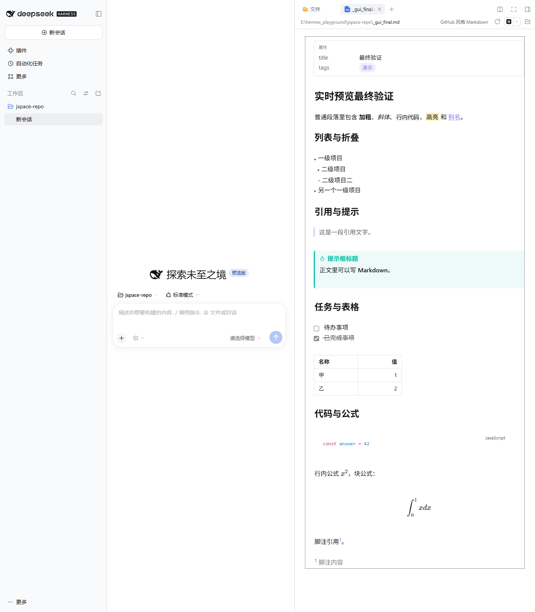
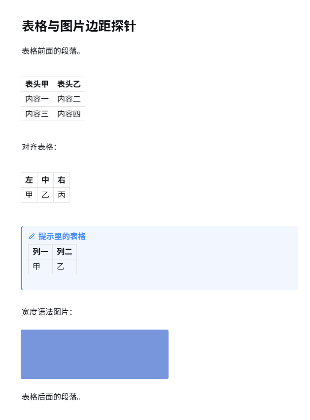
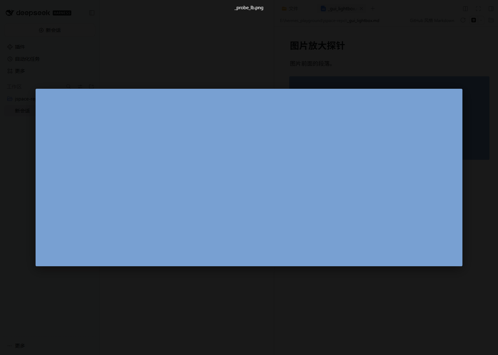

# dsh-live-markdown

[English](README.md) | 中文

给 [DeepSeek Harness](https://github.com/deepseek-ai/deepseek-harness) 文档面板用的 **Obsidian 式 Markdown 实时预览**。一份 Markdown 只在一个视图里打开：整篇按块渲染，只有你正在编辑的那一块（或整个选区）显示 Markdown 源码，不用在「渲染页」和「源码」之间来回切换。



## 功能

- **块级编辑**：光标所在块（或整个选区）显示源码，其余块保持渲染 —— 就是 Obsidian 的 Live Preview 行为。
- **参数来自真实 Obsidian 实测**：用 DevTools 协议读 Obsidian 1.15.1 的行盒与盒模型，不是凭感觉调：正文行高 **1.5**、标题上内边距 **16px**、列表行 **26–27px**、表格单元格高 **29.8px**、内边距 **4px/8px**、边框 **1px `#e4e4e4`**、表格按内容宽度、图片圆角 **4px**。
- **图片**：整行 `![[图片.png]]` 用块级 widget 渲染，占位高度就等于图片高度（不会多出半行空白）；`![[图片.png|300]]` 可指定宽度；**双击**打开 Obsidian 式灯箱（90% 黑底、等比适配、顶部文件名、点背景或 <kbd>Esc</kbd> 关闭）。
- **折叠**：标题、无序列表、有序列表、任务列表都可折叠（悬停显示箭头），折叠状态**按文件记忆**。
- **编辑快捷键**贴近 Obsidian：<kbd>Enter</kbd> 续写/退出列表与引用、<kbd>Backspace</kbd> 去掉列表标记、<kbd>Tab</kbd>/<kbd>Shift+Tab</kbd> 缩进、<kbd>Ctrl+B</kbd>/<kbd>Ctrl+I</kbd> 切换粗体斜体、<kbd>Ctrl+K</kbd> 插入 wikilink、<kbd>Ctrl+Enter</kbd> 勾选任务、<kbd>Ctrl+Shift+K</kbd> 删行、<kbd>Ctrl+Shift+V</kbd> 纯文本粘贴、<kbd>Ctrl+S</kbd> 保存。
- **表格**可直接编辑：点单元格输入、<kbd>Tab</kbd> 在单元格间移动、右键插入/删除行列与左中右对齐。
- **各种块**按 Obsidian 观感渲染：callout（类型配色、Lucide 图标、`-`/`+` 折叠）、引用、任务列表、代码块（语言标签 + 复制按钮）、KaTeX 公式、frontmatter 属性卡片（tag 显示胶囊）、脚注上标、`==高亮==`、`<kbd>`。
- **链接与嵌入**：`[[笔记|别名]]` 只显示别名、`![[笔记]]` 内联渲染目标笔记、悬停 wikilink 显示预览卡片、`![[图片]]`/`` 内联显示。
- **粘贴/拖入图片**会自动存到笔记旁边并插入 `![[文件名]]`。
- **长文档不卡**：装饰按视口构建，6600 行文档单次装饰重建约 5ms、按键往返约 10ms。
- **不丢字**：为性能做了节流，但保存、切换文件、卸载前都会 flush。

## 截图

表格与图片按 Obsidian 盒模型渲染（表格按内容宽度、图片铺满正文列）：



双击图片打开灯箱（结构与 Obsidian 内置灯箱一致：遮罩、等比图片、文件名标题栏）：



标题/正文/列表使用 Obsidian 实测行高：


## 安装

### 环境要求

- DSH **0.2.2-rc.3** 或更新（`engines.dsh` 已声明）。本插件是 DSH 的 *bundle*，没有安装脚本，不需要批准构建权限。
- 不需要其它依赖：CodeMirror 6、marked、KaTeX、DOMPurify、Shiki 与 Literata 字体都随包内置，离线可用。

### 从 GitHub 安装

```sh
dsh plugin --profile desktop add github:Paradeluxe/dsh-live-markdown
```

`desktop` 换成你实际使用的 profile 名。也可以在应用里用 **插件 → 添加插件** 指向本地目录。

### 从 npm 安装

```sh
dsh plugin --profile desktop add @paradeluxe/dsh-live-markdown
```

如果 npm 上还没有这个包，用上面的 GitHub 命令，代码相同。

### 启用

打开 **插件**，找到 **Obsidian 式 Markdown 实时预览** 并确认已启用，然后在工作区面板里打开任意 `.md` 文件。预览标题栏保留「切回官方渲染器」的开关，不会被强制接管。

## 与 Obsidian 的对齐程度

[`PARITY.md`](PARITY.md) 列出 52 项 Live Preview 行为、实现状态以及对应的验证项。部分实测对照：

| 行为 | Obsidian 1.15.1（实测） | 本插件 |
|---|---|---|
| 活跃块显示源码、其余渲染 | ✓ | ✓ |
| 失焦时整篇渲染 | ✓ | ✓ |
| 活跃范围 = 整个选区 | ✓ | ✓ |
| 正文/标题行高 | 24px / 45–48px（标题上内边距 16px） | 24px / 44–47px |
| 表格单元格 | 高 29.8px、内边距 `4px 8px`、边框 1px `#e4e4e4` | 一致 |
| 图片点击 | 单击无反应、双击开灯箱 | 一致 |
| 灯箱 | `.lightbox` + `rgba(0,0,0,.9)` 遮罩 + 文件名栏 | 一致 |
| wikilink 点击 | 打开目标笔记 | 复制目标（见限制） |

已知限制（如实记录在 `PARITY.md`）：

- **点击 wikilink/嵌入是复制目标，而不是打开笔记**：DSH 的文档预览没有「打开其它文件」的宿主 API。
- **属性卡片是编辑原始 YAML**，没有复刻 Obsidian 的属性类型下拉与「+ 添加属性」。
- 图谱视图、反向链接、命令面板、Vim 模式属于宿主或编辑器能力，不在 Markdown 渲染器范围内。
- 配色按 Obsidian 浅色主题近似，深色主题未单独调色。

## 实现方式

`index.js` 是 Host 侧：注册文档预览渲染器，并在桌面端本地服务上提供一个小型工作区 API（list/tree/read/save 以及用于粘贴图片的 `asset`）。`client.js` 是 Web 侧：负责预览面板，为整篇笔记挂一个 CodeMirror 6 `EditorView`，把装饰、块 widget、折叠状态、选区、撤销历史与保存节流按文件记忆。`src/cm6-entry.js` 是该编辑器在 CodeMirror 一侧的实现，由 `scripts/build-client.mjs` 打包成 `vendor/cm6-live-preview.js`。

## 开发

```sh
npm install
npm run build:client   # src/cm6-entry.js -> vendor/cm6-live-preview.js
npm run smoke          # 用示例文档跑一遍 Host 侧渲染
```

插件在 DSH 0.2.2-rc.3 上用 Playwright 自动化回归（42 个脚本 / 200+ 断言）验证过：活跃行语义、折叠、快捷键、表格、callout、嵌入、图片粘贴、灯箱、长文档滚动、保存后重开一致性。回归套件跑在临时 DSH profile 上，不随包发布。

## 第三方资源

`vendor/` 下内置的资源与许可证：

| 资源 | 许可证 |
|---|---|
| CodeMirror 6 | MIT |
| marked、marked-footnote | MIT |
| KaTeX | MIT |
| Shiki | MIT |
| DOMPurify | Apache-2.0 OR MPL-2.0 |
| Literata（字体） | SIL Open Font License 1.1 |

## 许可证

MIT，见 [LICENSE](LICENSE)。
